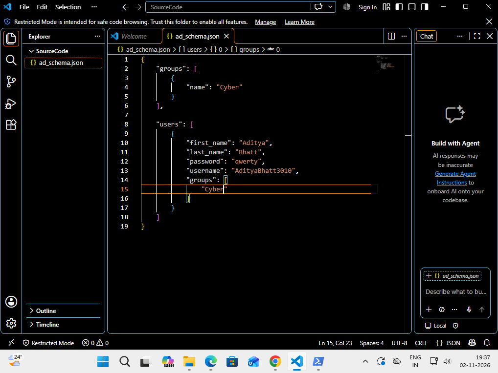
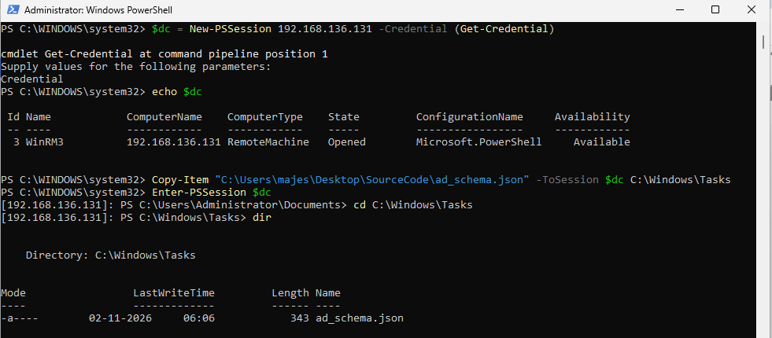
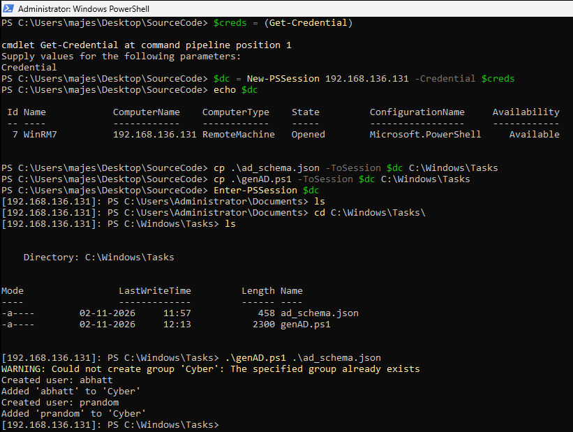
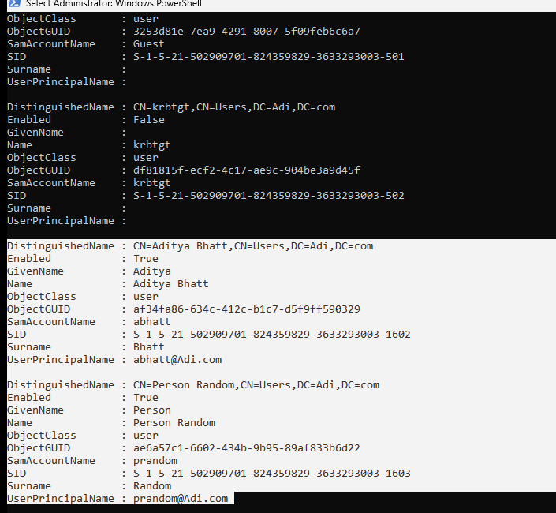
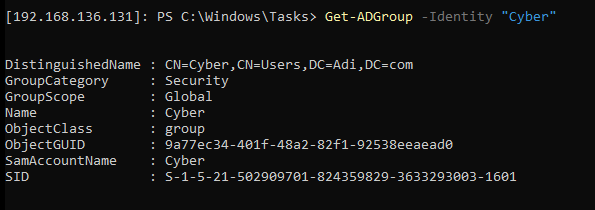
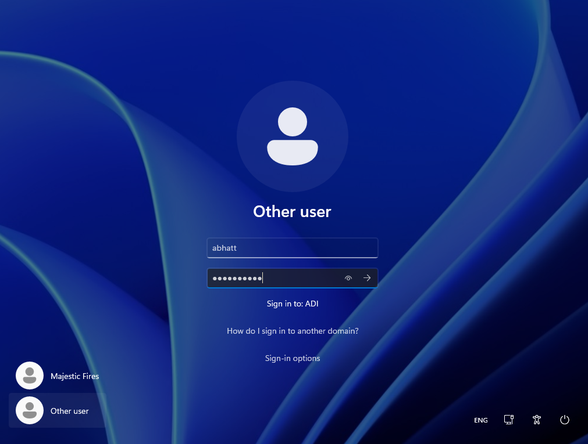
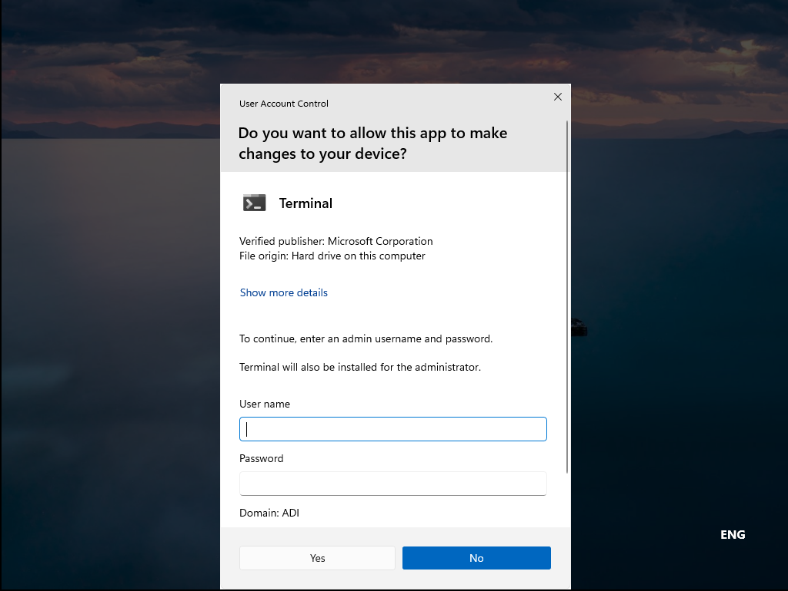

# Automating Domain Users in Active Directory

Automate Active Directory group and user creation using PowerShell and JSON, with remote execution through PowerShell Remoting.

## Overview

This Proof of Concept (PoC) demonstrates how to automate the creation of Active Directory (AD) security groups and domain users using a JSON configuration file and a PowerShell script.

Instead of manually creating each user and assigning group memberships through Active Directory Users and Computers (ADUC), we define the required objects in JSON and let PowerShell handle the creation process.

### Lab Environment

| Component | Configuration |
|---|---|
| Domain Controller (DC) | Windows Server 2022 Evaluation Edition |
| Management Client (MC) | Windows 11 |
| Workstation (WS) | Windows 11 |
| Scripting | PowerShell |
| Configuration | JSON |
| Remote Management | PowerShell Remoting |
| Editor | Visual Studio Code |
| Version Control | Git |

For the initial Active Directory lab setup, refer to [Active Directory Setup](https://github.com/AdityaBhatt3010/Active-Directory-Setup).

## Prerequisites

### 1. Install Git

MC - PowerShell (Administrator):

```powershell
winget install --id Git.Git -e --source winget
```

### 2. Install Visual Studio Code

Download and install [Visual Studio Code](https://code.visualstudio.com/download) on the Management Client.

## Step 1: Create the JSON Schema

On the MC, create a file named `ad_schema.json`.

Initially, the JSON configuration contains a group and a user with separate first and last name fields.

PAYLOAD

```json
{
    "groups": [
        {
            "name": "Cyber"
        }
    ],
    "users": [
        {
            "first_name": "Aditya",
            "last_name": "Bhatt",
            "password": "qwerty",
            "username": "AdityaBhatt3010",
            "groups": [
                "Cyber"
            ]
        }
    ]
}
```



This initial schema establishes the basic structure for defining groups and users. The first version of the script will simply read and display the user objects, allowing us to validate the JSON input before implementing AD operations.

## Step 2: Establish a Remote PowerShell Session

We can connect directly to the DC using `New-PSSession`. However, rather than creating a session and immediately entering it, we store the session in a variable so that it can be reused for file transfers and remote execution.

MC - PowerShell:

PAYLOAD

```powershell
$dc = New-PSSession -ComputerName IP -Credential (Get-Credential)
echo $dc
```

Replace `IP` with the IP address of the Domain Controller.

The session variable `$dc` represents the remote PowerShell session. We can use it to execute commands on the DC without repeatedly establishing a new connection.

Next, transfer the required files to the DC.

MC - PowerShell:

PAYLOAD

```powershell
Copy-Item -Path "PATH" -Destination "C:\Windows\Tasks" -ToSession $dc
Enter-PSSession $dc
cd C:\Windows\Tasks
dir
```

Replace `PATH` with the local file path of the file being transferred.

`Copy-Item -ToSession` transfers the file from the MC to the remote DC. `Enter-PSSession` then switches the interactive PowerShell session to the DC.



## Step 3: Create a Dummy PowerShell Script

On the MC, create `genAD.ps1`.

For the first version, the script accepts a JSON file, parses its contents, and displays the user objects.

PAYLOAD

```powershell
param(
    [Parameter(Mandatory = $true)]
    $JSONFile
)

$json = Get-Content $JSONFile | ConvertFrom-Json

echo $json.users
```

### Execute the script

MC - PowerShell:

PAYLOAD

```powershell
Set-ExecutionPolicy RemoteSigned
.\genAD.ps1 .\ad_schema.json
```

`Get-Content` reads the JSON file, while `ConvertFrom-Json` converts it into PowerShell objects. Accessing `$json.users` displays the user entries.

This is a basic validation step before introducing Active Directory cmdlets.

## Step 4: Modify the JSON Schema

We now modify `ad_schema.json` to include the domain name and simplify the user definition.

The updated schema uses a full name and includes two users, both assigned to the `Cyber` group.

PAYLOAD

```json
{
    "domain": "Adi.com",
    "groups": [
        {
            "name": "Cyber"
        }
    ],
    "users": [
        {
            "name": "Aditya Bhatt",
            "password": "Qwerty@123",
            "groups": [
                "Cyber"
            ]
        },
        {
            "name": "Person Random",
            "password": "QwertY@456",
            "groups": [
                "Cyber"
            ]
        }
    ]
}
```

The `domain` field is used to construct each user's User Principal Name (UPN). The `groups` array defines the AD groups to create, while each user's own `groups` array specifies their memberships.

## Step 5: Implement Active Directory Automation

Replace the dummy contents of `genAD.ps1` with the following script.

PAYLOAD

```powershell
param(
    [Parameter(Mandatory = $true)]
    [string]$JSONFile
)

Import-Module ActiveDirectory -ErrorAction Stop

# Load JSON configuration
$json = Get-Content -Path $JSONFile -Raw | ConvertFrom-Json
$Global:Domain = $json.domain

function CreateADGroup()
{
    param(
        [Parameter(Mandatory = $true)]
        $groupObject
    )

    $name = $groupObject.name

    # Create AD group
    try
    {
        New-ADGroup -Name $name -GroupScope Global -ErrorAction Stop
        Write-Host "Created group: $name"
    }
    catch
    {
        Write-Warning "Could not create group '$name': $_"
    }
}

function CreateADUser()
{
    param(
        [Parameter(Mandatory = $true)]
        $userObject
    )

    # Pull name and password from JSON object
    $name = $userObject.name
    $password = $userObject.password

    # Split full name into first name and last name
    $firstname, $lastname = $name.Split(" ", 2)

    # Generate username: first initial + last name
    $username = ($firstname[0] + $lastname).ToLower()

    $samAccountName = $username
    $principalName = "$username@$Global:Domain"

    # Create AD user
    try
    {
        New-ADUser `
            -Name $name `
            -GivenName $firstname `
            -Surname $lastname `
            -SamAccountName $samAccountName `
            -UserPrincipalName $principalName `
            -AccountPassword (ConvertTo-SecureString $password -AsPlainText -Force) `
            -Enabled $true `
            -ErrorAction Stop

        Write-Host "Created user: $username"
    }
    catch
    {
        Write-Warning "Could not create user '$name': $_"
        return
    }

    # Add user to groups
    foreach ($group_name in $userObject.groups)
    {
        try
        {
            Get-ADGroup -Identity $group_name -ErrorAction Stop |
                Out-Null

            Add-ADGroupMember `
                -Identity $group_name `
                -Members $samAccountName `
                -ErrorAction Stop

            Write-Host "Added '$username' to '$group_name'"
        }
        catch
        {
            Write-Warning "Could not add '$username' to '$group_name': $_"
        }
    }
}

# Create groups
foreach ($group in $json.groups)
{
    CreateADGroup $group
}

# Create users
foreach ($user in $json.users)
{
    CreateADUser $user
}
```

### How the script works

**1. Load the configuration**

The script imports the Active Directory module and parses the JSON file. The domain value is stored in `$Global:Domain` so that it can be accessed by the user-creation function.

**2. Create AD groups**

`CreateADGroup` reads each group's name from the JSON configuration and uses `New-ADGroup` to create a global security group.

**3. Generate usernames**

`CreateADUser` splits the full name into first and last names, then generates a username using the first initial followed by the surname.

For example:

| Full Name | Generated Username |
|---|---|
| Aditya Bhatt | abhatt |
| Person Random | prandom |

The generated username is used for the `sAMAccountName` and the UPN is constructed using the configured domain.

**4. Create domain users**

`New-ADUser` creates the account with the configured name, username, UPN, and password. The password is converted to a `SecureString` for the cmdlet.

**5. Assign group memberships**

For each group specified in a user's JSON entry, the script verifies that the group exists and then uses `Add-ADGroupMember` to add the user.

The `try/catch` blocks report failures without terminating the entire process when an individual group or user operation fails.

## Step 6: Transfer and Execute the Script on the DC

On the MC, create a credential object and establish a remote session.

MC - PowerShell:

PAYLOAD

```powershell
$creds = Get-Credential

$dc = New-PSSession -ComputerName 192.168.136.131 -Credential $creds

echo $dc
```

Transfer the JSON configuration and PowerShell script to the DC.

MC - PowerShell:

PAYLOAD

```powershell
Copy-Item .\ad_schema.json -ToSession $dc -Destination C:\Windows\Tasks

Copy-Item .\genAD.ps1 -ToSession $dc -Destination C:\Windows\Tasks
```

Enter the remote session and execute the script.

MC - PowerShell:

PAYLOAD

```powershell
Enter-PSSession $dc

cd C:\Windows\Tasks

ls

.\genAD.ps1 .\ad_schema.json
```

The script runs on the DC, where the Active Directory module is available and the necessary domain permissions can be applied.



## Step 7: Verify the Created Users

After the script completes, verify that the new users exist in Active Directory.

DC - PowerShell:

PAYLOAD

```powershell
Get-ADUser
```

The command lists the domain users, including the accounts created by our script.



## Step 8: Verify the Created Group

Check whether the `Cyber` group was created successfully.

DC - PowerShell:

PAYLOAD

```powershell
Get-ADGroup -Identity "Cyber"
```

This retrieves the AD group object and confirms that the group exists.



## Step 9: Test Domain User Login

Finally, switch to the Windows 11 Workstation and sign in using one of the newly created domain accounts.

WS - Windows Sign-in:

```text
Adi.com\abhatt
```

Use the corresponding password configured in `ad_schema.json`.

Successful authentication confirms that the account was created and can be used to log in to a domain-joined workstation.



## Step 10: Verify Domain Membership and Administrative Policy

On the WS, open Command Prompt as Administrator. Windows prompts for credentials with the necessary administrative privileges.



This final step demonstrates that the workstation is operating within the domain environment and that domain-managed policies and administrative controls apply.

## Key Takeaways

- JSON provides a structured, reusable configuration for AD users and groups.
- PowerShell automates account creation, username generation, and group membership assignment.
- PowerShell Remoting enables centralized administration from a Management Client.
- Verification through AD cmdlets and a workstation login confirms the end-to-end workflow.

## Security Considerations

- The passwords in this PoC are demonstration credentials. Never use them in a production environment.
- Avoid storing plaintext passwords in JSON files or version control. Use a secure secret-management solution for real deployments.
- Use a dedicated account with only the permissions required to create users and groups.
- Consider adding duplicate-account handling, input validation, password policy enforcement, and logging before using this automation in a larger environment.

---

**Aditya Bhatt**

---
